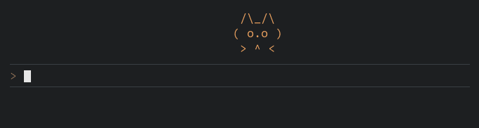
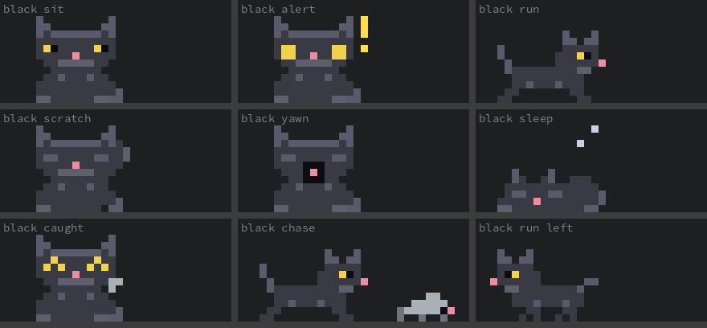

# claude-neko

An [xneko](https://en.wikipedia.org/wiki/Neko_(software))-style pixel-art cat for
[Claude Code](https://claude.com/claude-code). It lives in a band above the prompt:



<sub>Frames rendered from the mod's own animation code; the long naps are sped up.</sub>

- **You type** - the cat runs to your cursor and follows it.
- **Claude works** - it runs about the band and never sleeps.
- **Nothing happens** - it sits, scratches, yawns, then falls asleep.
- **Woken from a rest** - it startles, wide-eyed, before it runs, like the original.
- **Quiet for 30 seconds** - a mouse creeps in. The cat wakes, gives chase,
  corners it and looks very pleased with itself. Typing or Claude starting work
  scares the mouse off.

`/neko` hides or shows it.

## Pixel art or ASCII

The cat is drawn as full-colour pixel art: two pixels to a terminal cell, using
half-block characters. That needs a terminal with true colour (iTerm2, Ghostty,
kitty, WezTerm, Windows Terminal, VS Code, and most modern terminals) and takes a
six-row band.

Where the terminal doesn't report true colour, the band is too short, or you're
on the desktop app, it falls back to a coloured ASCII cat in three rows:


Pick one in `/config` under the plugin's **Style** option: `auto` (the default:
pixel art where `COLORTERM` says `truecolor` or `24bit`), `pixel` or `ascii`.

## Pick a cat

Two cats so far, set in `/config` under the plugin's **Cat** option:

- `tabby` (the default) - orange, green-eyed, white paws.
- `black` - charcoal with yellow eyes. Its ears and stripes are a lighter sheen, so it
  still shows on a dark terminal.



## Install

At the prompt of a Claude Code terminal session:

```
/plugin install neko --marketplace bgidley/claude-neko
```

Answer `y` to add the marketplace, then pick a scope (user scope is first).

From a shell:

```
claude plugin install neko --marketplace bgidley/claude-neko
```

In the desktop app, where `/plugin` does not run: click **+** next to the
prompt box, then **Plugins**, **Add marketplace** with `bgidley/claude-neko`,
then **Add plugin**.

## How it works

- `hooks/neko-logic.ts` - xneko's state machine (run, alert, sit, scratch, yawn,
  sleep, caught) and the mouse, shared by both styles, plus the ASCII sprites.
- `hooks/pixel.ts` - the pixel sprites and their encoding as `Raster` cells.
- `hooks/register.tsx` - the hooks module. It draws the band above the prompt,
  tracks the prompt's caret, registers `/neko`, and animates the pixel cat on a
  100ms timer, repainting it with `$.ui.blit`.
- `hooks/neko-client.ts` - the ASCII fallback, a surface module that animates
  itself on the terminal's frame clock.

## Development

```
claude --plugin-dir .          # run a session with the mod loaded
claude plugin validate .
claude plugin test .
```

## License

Apache License 2.0 - see [LICENSE](LICENSE).
